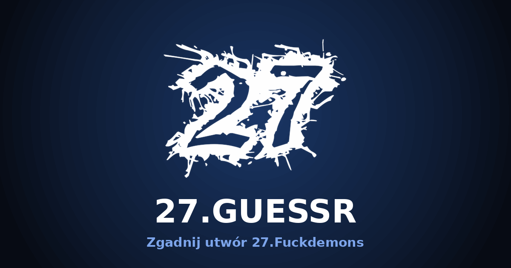

# 27.GUESSR

[](https://github.com/szymon-off/27.guessr/actions/workflows/sync-catalog.yml)

## ▶ [Zagraj teraz — szymon-off.github.io/27.guessr](https://szymon-off.github.io/27.guessr/)

Zgadnij utwór **27.Fuckdemons** w sześciu próbach. Każda pomyłka odblokowuje
więcej muzyki — od 0,1 s do 16 s.

Gra w stylu Heardle, inspirowana [33hit.pl](https://www.33hit.pl/), w niebieskiej
odsłonie.

[](https://szymon-off.github.io/27.guessr/)

## Jak grać

| | |
| --- | --- |
| **Dzień** | Jeden utwór dla wszystkich, ten sam do północy (czasu polskiego). Archiwum sięga dnia #1. |
| **Trening** | Losowy utwór, ile razy chcesz. Nie liczy się do statystyk. |

Sześć prób. Trafienie kończy rundę, pomyłka lub pominięcie odsłania kolejny
fragment: **0,1 s → 0,5 s → 2 s → 4 s → 8 s → 16 s**.

Kolory wierszy:

- 🟩 trafiony utwór
- 🟦 ten sam album lub EP, ale inny utwór
- 🟥 pudło
- ⬛ próba pominięta

Motywy: **Nocny**, **Jasny**, **Otchłań**. Spacja odtwarza i zatrzymuje fragment.

## Uruchomienie

```bash
npm install
npm run dev        # http://localhost:5173
```

| Skrypt | Co robi |
| --- | --- |
| `npm run dev` | serwer deweloperski |
| `npm run build` | typecheck + produkcyjny build do `dist/` |
| `npm run preview` | podgląd zbudowanej wersji |
| `npm test` | testy wyznaczania utworu dnia |
| `npm run catalog` | przebudowuje `src/data/catalog.json` z API Apple Music |
| `npm run catalog:verify` | sprawdza katalog i dostępność fragmentów (`-- --all` sprawdza wszystkie) |
| `npm run schedule` | dopisuje kolejne dni do `src/data/schedule.json` |
| `npm run sync` | to, co robi workflow: odświeża katalog i kalendarz, ale tylko gdy jest po co |

## Jak to działa

**Stos:** Vite + React + TypeScript. Bez backendu, bez kont, bez ciasteczek —
statyczne pliki i `localStorage`.

**Skąd muzyka.** `src/data/catalog.json` powstaje ze skryptu
`scripts/build-catalog.mjs`, który odpytuje publiczne API Apple Music
(iTunes Lookup) o wykonawcę `1491607120`. W repozytorium leżą wyłącznie
metadane i publiczne adresy 30-sekundowych fragmentów — **żadne audio ani teksty
nie są tu kopiowane ani rozpowszechniane**. Fragmenty odtwarzane są prosto z CDN
Apple, który wysyła `access-control-allow-origin: *`, dzięki czemu Web Audio może
je analizować i rysować falę bez żadnego pośrednika.

Katalog to **64 unikalne utwory** — 29 solowych i 35 gościnnych (Popkiller Młode
Wilki, Hotel Maffija, CBW, esceh, Petito i inni). Utwory z udziałem gości
pokazują pełną listę wykonawców w podpowiedziach i w wyniku.

**Utwór dnia.** Kalendarz leży w repo jako `src/data/schedule.json` — lista
„dzień → utwór", generowana przez `scripts/build-schedule.mjs`.
`src/game/daily.ts` tylko z niej czyta.

To celowo plik, a nie obliczenie. Wcześniej kolejność powstawała przez tasowanie
katalogu w przeglądarce — przez co **jeden nowy singiel przetasowywał wszystkie
dni, łącznie z tymi już rozegranymi**. Archiwum przepisywało sobie historię, a
wyniki przestawały się zgadzać między graczami. Plik to naprawia.

Zasady generatora:

- **Przeszłość jest zamrożona.** Dni do dzisiaj włącznie (plus jeden dzień
  zapasu) nigdy się nie ruszają.
- **Przyszłość można przetasować.** Dni, których nikt jeszcze nie widział — w
  interfejsie są zablokowane — generator rozdaje od nowa, dzięki czemu nowy
  utwór trafia do gry w kilka dni, a nie po wyczerpaniu całego kalendarza.
- **Bez powtórek.** Utwory rozdawane są z „worka": nowy worek otwiera się
  dopiero, gdy poprzedni się skończy, więc żaden utwór nie wróci, zanim zagrają
  wszystkie.

`tests/schedule.test.mjs` pilnuje każdej z tych własności, a osobny test
zaczyna psuć CI, gdy kalendarza zostaje mniej niż 180 dni.

**Logo.** `scripts/make-logo.py` (Pillow) zamienia źródłową grafikę
`public/logo-27-original.png` na biały znak z przezroczystym tłem plus favicon i
kartę OG. Motyw jasny odwraca go na czarny filtrem CSS (`--logo-filter`).
Skrypt jest potrzebny tylko do regeneracji — gotowe pliki są w repo.

## Testy

```bash
npm test                                   # kalendarz: stabilność i zapas
npm run catalog:verify                     # katalog + fragmenty audio
npm run build && npm run preview           # a w drugim terminalu:
node scripts/smoke.mjs http://localhost:4173
```

Smoke test wymaga przeglądarki Playwrighta (`npx playwright install chromium`);
`PLAYWRIGHT_SKIP_BROWSER_DOWNLOAD=1 npm install` pomija pobieranie, jeśli go nie
potrzebujesz.

`scripts/smoke.mjs` przechodzi w Chromium pełną rundę — odtwarza fragment,
oddaje błędny strzał, pomija próbę, trafia — i zapisuje zrzuty wszystkich
motywów do `screenshots/`. Domyślnie podstawia lokalnie wygenerowany dźwięk;
`--live` odtwarza prawdziwe fragmenty z Apple.

## Gdy 27 wypuści nowy utwór

Dzieje się to samo. `.github/workflows/sync-catalog.yml` co tydzień, w
poniedziałek o 1:00 (zimą) lub 2:00 (latem) czasu polskiego, pyta Apple
Music o nowe wydania i — jeśli jest co wdrażać — otwiera PR `bot/catalog-sync`
z gotowym katalogiem i kalendarzem. Wystarczy go zmergować; deploy rusza sam.

Workflow jest wybredny, żeby nie zasypywać PR-ami (logika w
`scripts/sync-catalog.mjs`, testy w `tests/sync-catalog.test.mjs`):

- **Cisza przy rutynie.** Apple co kilka tygodni podmienia adresy fragmentów u
  kilkunastu utworów, a stare dalej działają — to nie powód do PR-a. Nowy adres
  jest przyjmowany tylko tam, gdzie stary przestał odpowiadać.
- **Nowy utwór dopiero, gdy gra.** Jeśli Apple już go wystawił, ale fragment
  jeszcze się nie odtwarza, utwór czeka do następnego przebiegu.
- **Zmiany tytułu, wykonawców, albumu lub daty** istniejącego utworu trafiają do
  PR-a; okładki i długości — nie.
- **Kalendarz też się sam dopisuje**, gdy zostaje mu mniej niż 365 dni.
- **Zero zmian w przeszłości.** Kalendarz jest zamrożony na 9 dni do przodu, a po
  przeliczeniu skrypt sprawdza, że każdy zamrożony dzień jest identyczny z
  poprzednim. Dzięki temu PR, który poleży kilka dni, nie ruszy utworów, które w
  międzyczasie zdążyły zagrać — zmerguj go w ciągu tygodnia. Nowy utwór trafia
  do gry po ok. 9 dniach.
- **Opis PR-a** pokazuje, kiedy każdy nowy utwór po raz pierwszy zagra, i
  ostrzega o remiksach oraz utworach podobnych do już istniejących.
- **Utwór zniknął z Apple.** Jeśli fragment dalej działa, zostaje w grze. Jeśli
  nie, workflow niczego nie zmienia i zakłada jedno zgłoszenie „Catalog sync
  needs attention" (zamyka je samo, gdy problem zniknie).

Jednorazowa konfiguracja: **Settings → Actions → General → Workflow permissions →
„Allow GitHub Actions to create and approve pull requests"**. Opcjonalnie
sekret `SYNC_TOKEN` (osobisty token z uprawnieniami `contents`, `pull requests`,
`issues`) sprawia, że PR uruchamia inne workflowy. Ręcznie: zakładka Actions →
Sync catalog → Run workflow (`dry_run` sprawdza wszystko bez PR-a). GitHub
wyłącza zaplanowane workflowy po 60 dniach bez aktywności w repo — wtedy wystarczy
włączyć go ponownie.

To samo lokalnie:

```bash
npm run sync             # katalog + kalendarz, z całą logiką decyzji
git diff src/data        # co się zmieniło
```

Albo ręcznie, krok po kroku (`npm run catalog` nadpisuje wszystko bez filtra):

```bash
npm run catalog
npm run schedule
npm test
```

Apple potrafi wystawić ten sam utwór kilka razy (singiel, potem EP, potem
składanka) — deduplikacja zostawia najwcześniejsze wydanie i woli wersję
solową. Zdarza jej się też zmieniać wielkość liter w tytułach; od tego jest
mapa `TITLE_OVERRIDES` na górze `scripts/build-catalog.mjs`.

## Wdrożenie

Gra działa na **[szymon-off.github.io/27.guessr](https://szymon-off.github.io/27.guessr/)**.

Build jest w pełni statyczny, z relatywnym `base`, więc działa pod dowolną
ścieżką. `.github/workflows/deploy.yml` publikuje go na GitHub Pages przy każdym
pushu na `main`; ten sam katalog `dist/` wrzucisz też na Netlify, Vercel czy
własny serwer.

## Zastrzeżenie

Nieoficjalny projekt fanowski, bez związku z 27.Fuckdemons, jego wytwórnią,
Apple ani z 33HIT. Fragmenty audio i okładki pochodzą z publicznego API Apple
Music i pozostają własnością ich właścicieli.
